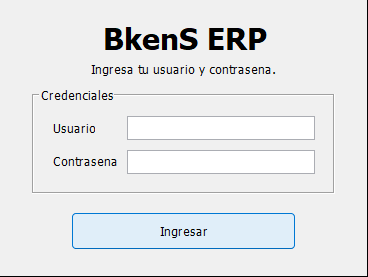
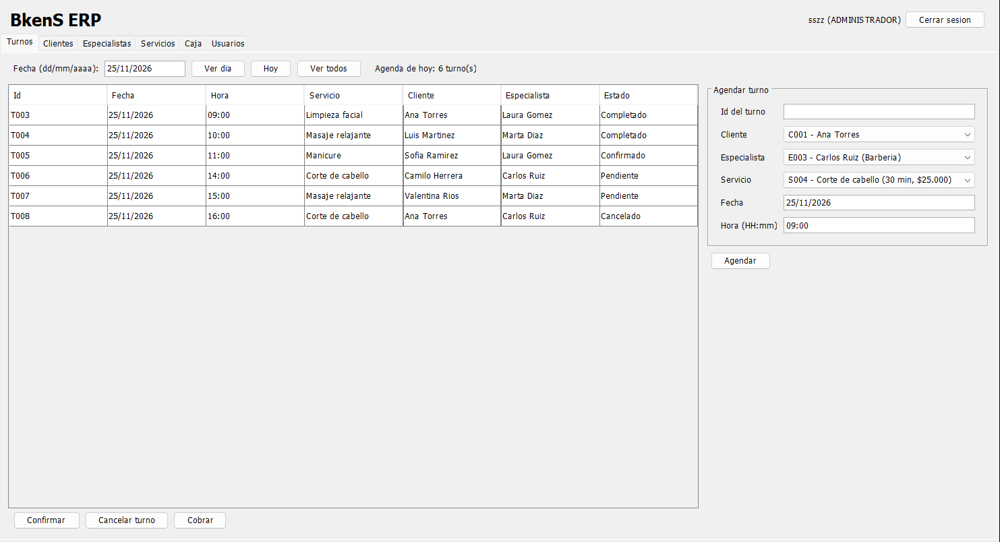
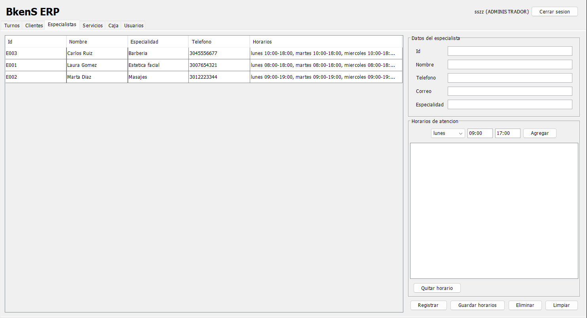
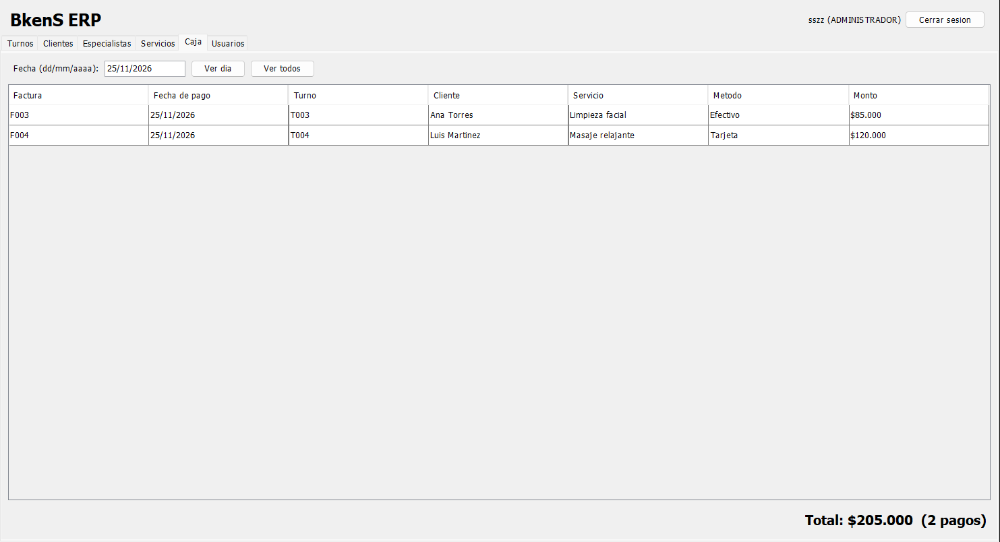
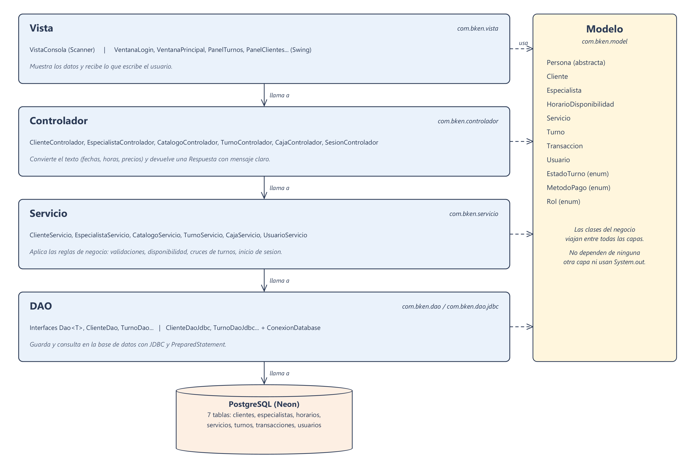

# BkenS ERP

Aplicación de escritorio en Java para gestionar la agenda, el personal, los servicios, los cobros y el acceso de un pequeño centro de estética.

Proyecto académico individual de Programación II (Institución Universitaria Antonio José Camacho).

## Problema

En muchos centros de estética las citas se agendan por WhatsApp o por llamada, sin una agenda ordenada. Así es fácil que se crucen citas, que se olvide a quién se atendió o cuánto se cobró, y cualquier persona puede modificar la información.

BkenS ERP reúne en un solo sistema la agenda de turnos, la disponibilidad de cada especialista, el catálogo de servicios y la caja, y verifica automáticamente las reglas del negocio.

## Funcionalidades

- Inicio de sesión con roles: **administrador** (todo), **recepcionista** (clientes, turnos y caja) y **especialista** (consulta de la agenda). La primera vez que se usa, el sistema pide crear el administrador.
- Clientes, especialistas con sus horarios de atención y catálogo de servicios.
- Agenda de turnos: agendar, confirmar, cancelar y cobrar.
  - No permite agendar fuera del horario del especialista.
  - No permite turnos que se crucen con otro del mismo especialista o del mismo cliente.
  - Al cobrar, el pago toma el precio del servicio.
- Caja: pagos y total por día o en general.
- Dos interfaces sobre la misma lógica: **ventanas (Swing)** y **consola (Scanner)**.

## Pantallas

| Inicio de sesión | Agenda de turnos |
|---|---|
|  |  |

| Especialistas y horarios | Caja |
|---|---|
|  |  |

Todas las capturas están en [docs/pantallas](docs/pantallas).

## Arquitectura

El código se organiza en capas (MVC con DAO). Cada capa solo llama a la de abajo:



| Paquete | Responsabilidad |
|---|---|
| `com.bken.model` | Clases del negocio y sus reglas (`Turno.cobrar()`, `Especialista.estaDisponible()`...). |
| `com.bken.dao` / `com.bken.dao.jdbc` | Interfaces DAO y sus implementaciones con JDBC y `PreparedStatement`. |
| `com.bken.config` | `ConexionDatabase`: abre la conexión con los datos de `config.properties`. |
| `com.bken.servicio` | Reglas de negocio: validaciones, disponibilidad, cruces de turnos, inicio de sesión. |
| `com.bken.controlador` | Convierte lo que escribe el usuario y devuelve una `Respuesta` con un mensaje claro. |
| `com.bken.vista` | Interfaz de consola (`VistaConsola`) y ventanas Swing (`vista.swing`). |

## Diagramas

- [Casos de uso](docs/diagramas/casos-de-uso.png)
- [Modelo de dominio (clases)](docs/diagramas/modelo-de-dominio.png)
- [Persistencia: DAO, JDBC y control de acceso](docs/diagramas/persistencia-dao.png)
- [Modelo de datos (tablas de PostgreSQL)](docs/diagramas/modelo-de-datos.png)

## Tecnologías

- Java 17 y Swing
- PostgreSQL (alojado en Neon) con el driver JDBC `org.postgresql:postgresql`
- Maven
- JUnit 5

## Cómo ejecutar

1. **Base de datos.** En una base PostgreSQL (por ejemplo, un proyecto gratuito en [Neon](https://neon.tech)), ejecuta:
   - [`db/schema.sql`](db/schema.sql): crea las 7 tablas.
   - [`db/datos-ejemplo.sql`](db/datos-ejemplo.sql) (opcional): carga datos de demostración. Los usuarios `recepcion` y `laura` tienen la contraseña `clave123`.
   - [`db/reiniciar-datos.sql`](db/reiniciar-datos.sql) (opcional): borra los datos del negocio, sin tocar los usuarios, para volver a cargar los de ejemplo.
2. **Conexión.** Copia `config.properties.example` como `config.properties` y escribe la URL, el usuario y la contraseña. Este archivo no se sube al repositorio.
3. **Ejecutar:**
   - Ventanas: clase `com.bken.MainSwing`
   - Consola: clase `com.bken.Main`

   Desde la terminal:

   ```
   mvn compile
   mvn exec:java -Dexec.mainClass=com.bken.MainSwing
   ```

   En VS Code también se puede usar el enlace **Run** sobre el método `main`.
4. **Pruebas:** `mvn test` (71 pruebas automatizadas).

## Decisiones de diseño

- `Persona` es abstracta y concentra los datos comunes; `Cliente` y `Especialista` la especializan.
- `EstadoTurno`, `MetodoPago` y `Rol` son enumeraciones: evitan valores de texto libre. En la base de datos, restricciones `CHECK` limitan las columnas a esos mismos valores.
- `HorarioDisponibilidad` es una clase propia, para que `Especialista.estaDisponible()` pueda evaluar la disponibilidad.
- `Turno` controla su ciclo de vida con `confirmar()`, `cancelar()` y `cobrar()`. Solo `cobrar()` crea la `Transaccion`, con el precio del servicio.
- Las contraseñas se guardan como hash SHA-256, nunca en texto plano.
- Los DAO usan `PreparedStatement`, lo que evita la inyección SQL. Las operaciones de varios pasos (especialista con sus horarios, cobro de un turno) se ejecutan en una transacción: se guarda todo o nada.
- Los servicios reciben los DAO por el constructor, así que las pruebas usan DAO en memoria y no necesitan base de datos.
- El nombre "ERP" se refiere a que el sistema integra sobre los mismos datos la agenda, el personal, el catálogo, la facturación y el acceso. Inventario, nómina y reportes quedan como trabajo futuro.
